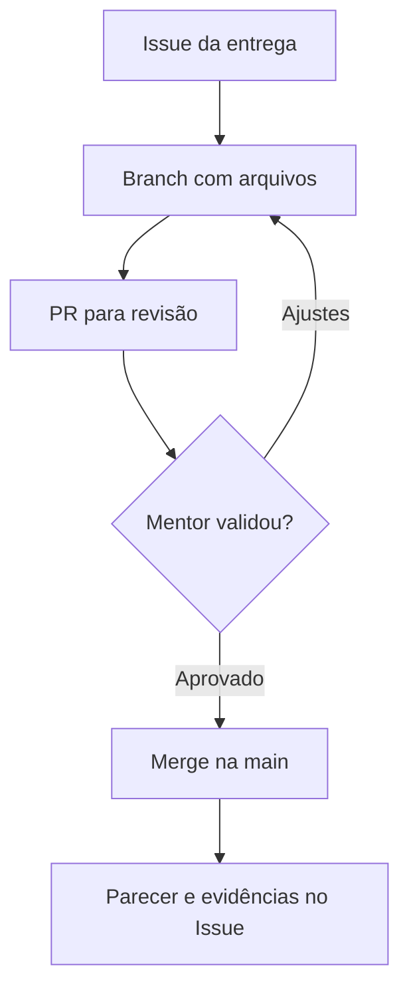

# Cookbook GitHub — alunos e mentores, passo a passo

**Desafio CRM Zero to Hero · edição de 22/10/2026**

Este guia ensina o caminho da primeira cópia do projeto até a avaliação final. Você pode fazer o pré-projeto inteiro pelo navegador, sem usar comandos de terminal. Para enviar o código de uma aplicação com muitos arquivos, há uma receita com GitHub Desktop.

**Repositório da turma:** https://github.com/Andre-cardia/desafio-crm-zero-to-hero

**Entrega final:** 14/12/2026, às 23h59. **Apresentações:** até 17/12/2026, às 22h. Horário de Brasília. O [regulamento](REFERENCIA-REPOSITORIO.md) é a referência de prazos, notas e exceções; este cookbook explica como executar as entregas.

## Comece pelo caminho do seu papel

| Quem é você? | O que fazer primeiro |
|---|---|
| Aluno iniciando | Receitas 1 a 7: criar sua cópia, dar acesso, enviar e pedir revisão. |
| Aluno com ajustes solicitados | Receitas 8 e 9: corrigir no mesmo PR e integrar após aprovação. |
| Aluno enviando o aplicativo | Receita 10: usar Desktop; depois seguir as receitas 7 e 11. |
| Mentor | Receita 2 para acesso; receitas 12 a 15 para revisar, testar e registrar o resultado. |
| Coordenador | Verificar acesso dos dois mentores, datas e registro do parecer; usar a receita 16 para acompanhar. |

Ao terminar cada receita, confira o **resultado esperado**. O botão pode aparecer em inglês; os nomes em negrito correspondem aos rótulos usuais do GitHub. Pequenas diferenças de tela podem ocorrer.

## Antes dos cliques: o que significa cada palavra?

| Palavra | Explicação simples | Exemplo neste desafio |
|---|---|---|
| Repositório | Pasta do projeto no GitHub, com histórico. | `crm-ana-silva` |
| Template | Modelo usado para criar uma cópia independente. | O repositório público da turma. |
| Branch | Linha de trabalho separada, dentro do mesmo repositório. | `docs/pre-projeto` |
| `main` | Branch principal; reúne o que já foi integrado. | Pré-projeto revisado e código aceito. |
| Commit | Registro de uma mudança, com autor e mensagem. | `docs: define usuários do CRM` |
| Push | Enviar os commits do computador ao GitHub. | Botão **Push origin** no Desktop. |
| Issue | Ficha de uma tarefa ou entrega, com conversa e acompanhamento. | **Marco 1 — Pré-projeto** |
| Pull Request, ou PR | Pedido para revisar e integrar mudanças de uma branch. | **Pré-projeto: contexto, MVP e protótipo** |
| Review | Revisão publicada por outra pessoa no PR. | Mentor pede ajuste no escopo. |
| Merge | Integração das mudanças aprovadas na branch de destino. | `docs/pre-projeto` entra em `main`. |
| SHA ou hash | Identificador de um commit; permite apontar uma versão exata. | Copiar o identificador completo na página do commit. |
| Tag | Nome associado a uma versão específica. | `entrega-final` |
| Release | Página de uma versão, com tag, descrição e downloads. | **Entrega final — CRM** |

**O aluno trabalha na própria cópia.** O modelo público contém o material da turma. Arquivos, Issues, PRs, feedback e notas de cada aluno ficam no repositório privado dele ou da dupla.

**Commit não é aprovação.** Salvar um arquivo não substitui abrir o PR e solicitar revisão. Um botão verde de merge também não comprova que o mentor avaliou a entrega.

## Onde cada coisa fica?

| O que você precisa guardar ou consultar | Local |
|---|---|
| Enunciado, tutorial e regras da turma | Modelo público e documentos copiados. |
| Trabalho do aluno: documentos, código e testes | Aba **Code**, no repositório do aluno. |
| Lista do que falta entregar | Issue do marco, no repositório do aluno. |
| Mudanças aguardando revisão | Aba **Pull requests**, no PR do marco. |
| Comentário sobre uma linha ou arquivo | PR → **Files changed**. |
| Decisão de revisão: aprovar ou pedir ajustes | PR → **Review changes** / **Submit review**. |
| Parecer do gate e links das revisões | Issue do marco, consolidado pelo mentor relator. |
| Nota final, fichas dos mentores e resultado | Issue **Entrega final — CRM**. |
| Versão final congelada | Tag `entrega-final` e hash completo registrados no Issue final. |



## Receita 1 — Aluno: criar seu repositório

**Você precisa:** estar conectado ao GitHub. Em dupla, escolham quem será dono do repositório; o outro integrante será colaborador.

1. Abra o [modelo oficial](https://github.com/Andre-cardia/desafio-crm-zero-to-hero).
2. Clique em **Use this template → Create a new repository**.
3. Em **Owner**, escolha sua conta.
4. Em **Repository name**, use um nome como `crm-ana-silva` ou `crm-equipe-01`.
5. Selecione **Private**, conforme o regulamento da avaliação.
6. Deixe **Include all branches** desmarcado. A branch principal basta.
7. Clique em **Create repository** e aguarde a lista de arquivos aparecer.
8. Copie a URL da página e guarde-a. Ela deve conter **seu usuário**, e não apenas o usuário da coordenação.

**Resultado esperado:** você vê `README.md`, `DESAFIO.md`, `docs/` e `templates/` dentro de `SEU-USUARIO/crm-seu-nome`.

Não é necessário criar outra cópia a cada entrega. Você usará esse mesmo repositório durante o desafio. O template não atualiza automaticamente sua cópia quando a coordenação altera o modelo.

## Receita 2 — Aluno e mentor: liberar e conferir o acesso

**Aluno**

1. Peça à coordenação os usuários GitHub do mentor relator e do mentor revisor.
2. No **seu repositório**, abra **Settings → Collaborators → Add people**.
3. Busque o usuário exato de cada mentor; confira o perfil antes de selecionar.
4. Envie o convite. Em dupla, convide também seu colega.
5. Informe aos convidados qual repositório devem acessar.
6. Aguarde a aceitação e confira a lista de colaboradores.

**Mentor**

1. Entre na conta que recebeu o convite.
2. Aceite-o pelo GitHub ou pelo e-mail de convite.
3. Abra a URL informada pelo aluno.
4. Confira se consegue ver **Code**, **Issues** e **Pull requests**.
5. Depois que o primeiro PR existir, confirme que consegue comentar e enviar uma revisão.

**Resultado esperado:** os dois mentores acessam o mesmo repositório privado. “Convite enviado” ainda não significa “acesso confirmado”.

Em um repositório privado de conta pessoal, o colaborador recebe acesso de escrita; não existe uma opção separada de colaborador somente para leitura. Em uma organização, a coordenação pode distribuir papéis mais específicos. O mentor deve revisar e orientar; a correção do trabalho continua sendo responsabilidade do aluno.

**Sobre proteção de branch:** não presuma que regras ou colaboradores foram copiados com o template. A disponibilidade de proteção automática varia conforme plano e visibilidade. Se não houver bloqueio automático, a regra da turma continua valendo: só integrar depois da revisão. Não torne o trabalho público para contornar essa limitação.

## Receita 3 — Aluno: abrir a ficha da entrega, chamada Issue

1. Abra **Issues → New issue** no seu repositório.
2. Se aparecer uma escolha de modelos, use a opção de Issue em branco para este exemplo.
3. Digite o título **Marco 1 — Pré-projeto**.
4. Cole e complete o texto abaixo.
5. Clique em **Create** ou **Submit new issue**, conforme a tela.
6. Anote o número gerado. Nos exemplos seguintes, `#1` representa esse número; substitua pelo seu.

```markdown
## Participantes
- Nome e usuário GitHub:

## Objetivo
Planejar um CRM para [usuário/contexto] que resolva [problema].

## Entrega
- [ ] pre-projeto.md preenchido
- [ ] Protótipo acessível
- [ ] MVP e itens fora do escopo definidos
- [ ] PR aberto e vinculado aqui
- [ ] Revisão dos mentores recebida
- [ ] Ajustes atendidos e parecer registrado

## Links
- PR: preencher depois de criá-lo
- Protótipo:

## Prazo
Documentos: 03/11/2026, às 23h59 — Brasília.
Apresentação: 04/11/2026, no horário individual da banca.

## Dúvidas ou impedimentos
Descrever, ou informar “nenhum”.
```

**Resultado esperado:** o Issue tem um endereço próprio e uma lista verificável. Ele acompanhará a entrega até o parecer.

Repita esse padrão para **Marco 2 — Plano BMAD** e **Entrega final — CRM**, usando os entregáveis e datas do regulamento. Uma história de implementação, como “Cadastrar contato”, também pode ter um Issue próprio.

## Receita 4 — Aluno: criar uma branch antes de enviar arquivos

**Você está em:** seu repositório → aba **Code**.

1. Localize o seletor de branch, geralmente acima da lista de arquivos.
2. Confirme que ele mostra `main`.
3. Abra o seletor e digite `docs/pre-projeto`.
4. Clique em **Create branch: docs/pre-projeto from main** ou opção equivalente.
5. Confirme que o seletor agora mostra `docs/pre-projeto`.

Se não aparecer a criação no seletor, abra **View all branches → New branch**, informe o nome e selecione `main` em **Source**.

**Resultado esperado:** suas próximas mudanças serão feitas em `docs/pre-projeto`. A `main` ainda não recebeu a entrega.

Para outro trabalho, crie outra branch a partir da `main` atualizada. Exemplos: `docs/plano-bmad`, `feat/contatos` e `fix/permissao-operador`.

## Receita 5 — Aluno: subir arquivos que já estão no computador

**Use esta receita para:** um documento, uma imagem de protótipo ou um pequeno conjunto de arquivos. Para o aplicativo com muitas pastas, prefira a receita 10.

1. Confira a branch `docs/pre-projeto` no seletor.
2. Na pasta de destino, clique em **Add file → Upload files**.
3. Clique em **Choose your files** ou arraste os arquivos.
4. Confira a lista apresentada: nomes, arquivos duplicados e destino.
5. Escreva uma mensagem, por exemplo `docs: adiciona pré-projeto e protótipo`.
6. Salve na **branch de trabalho atual**. Se a tela disser que o destino é `main`, volte e corrija a branch.
7. Clique em **Commit changes** e espere terminar.
8. Abra os arquivos no GitHub e confira se estão legíveis.

**Resultado esperado:** os arquivos aparecem na branch de trabalho, acompanhados da mensagem do commit.

### Organização sugerida para o primeiro envio

| Arquivo | Local | Como o mentor vai usar |
|---|---|---|
| `pre-projeto.md` | Raiz: primeiro nível do repositório. | Ler problema, usuário, fluxo e escopo. |
| `docs/prototipo/contatos.png` | Pasta do protótipo. | Conferir a tela de contatos. |
| `docs/prototipo/oportunidades.png` | Pasta do protótipo. | Conferir o fluxo comercial. |
| Link de Figma ou outro protótipo | Dentro de `pre-projeto.md`. | Abrir com a conta do mentor; teste o acesso antes. |

Para criar uma pasta pelo navegador, use **Add file → Create new file** e informe, por exemplo, `docs/prototipo/README.md`. A barra `/` cria os níveis do caminho. Depois abra essa pasta e faça o upload nela. Git não guarda pastas vazias.

Um arquivo enviado substituindo outro com **o mesmo caminho** registra uma nova versão. Evite `pre-projeto-final-v2-agora-vai.md`: mantenha `pre-projeto.md` e deixe o histórico mostrar a evolução.

### O que não enviar

- `.env`, senhas, tokens, chaves e certificados.
- Dados reais de clientes.
- Pastas como `node_modules/`, `.git/`, `.venv/` e arquivos temporários.
- Apenas um ZIP do código: o mentor precisa ler arquivos e diferenças diretamente no GitHub.

O upload pelo navegador aceita até **25 MiB por arquivo e 100 arquivos por vez**. Para vídeo grande, use um link acessível aos mentores. Não confie no `.gitignore` para revisar por você uma seleção manual no navegador; confira cada arquivo.

## Receita 6 — Aluno: criar ou editar Markdown sem instalar nada

### Criar seu pré-projeto a partir do modelo

1. Na sua cópia, abra `templates/pre-projeto.md`.
2. Use **Code** ou **Raw** na visualização do arquivo para copiar o texto Markdown.
3. Volte à raiz, mantendo a branch `docs/pre-projeto`.
4. Clique em **Add file → Create new file**.
5. Digite `pre-projeto.md` no campo **File name**.
6. Cole o modelo, preencha as respostas e substitua os exemplos.
7. Use **Preview** para conferir a leitura.
8. Clique em **Commit changes…**, escreva uma mensagem e confirme a branch de trabalho.

### Editar um arquivo existente

Abra o arquivo na branch correta, clique no lápis/**Edit file**, altere o texto, confira **Preview** e faça um novo commit. Guarde os modelos originais em `templates/`; preencha a cópia na raiz.

**Resultado esperado:** um documento preenchido, não somente o modelo vazio.

Exemplo mínimo de Markdown:

```markdown
# Meu CRM

## Problema
A equipe perde o histórico dos contatos em planilhas diferentes.

## Escopo
- Registrar contatos.
- Acompanhar oportunidades.
- Organizar próximas atividades.

## Conferência
- [x] Problema definido
- [ ] Protótipo revisado

[Tela de contatos](docs/prototipo/contatos.png)
```

Salve como `.md`, sem uma extensão extra como `.md.txt`.

## Receita 7 — Aluno: abrir o PR e pedir a revisão

**Só faça isso depois que houver mudanças salvas na branch.**

1. Abra **Pull requests → New pull request**.
2. Confira o repositório: deve ser o seu, não o modelo da coordenação.
3. Selecione **base: main** e **compare: docs/pre-projeto**.
4. Examine a lista de diferenças antes de continuar.
5. Clique em **Create pull request**.
6. Use o título **Pré-projeto: contexto, MVP e protótipo**.
7. Preencha a descrição. Se o modelo automático aparecer, complete-o; não deixe campos vazios.
8. Publique como PR pronto para revisão. Use **Draft** somente se o trabalho ainda não estiver pronto para o mentor.
9. Em **Reviewers**, selecione os dois mentores. Se a opção não aparecer, confira o acesso e compartilhe o link pelo canal combinado.
10. Copie a URL do PR para o Issue da receita 3.

**Resultado esperado:** o mentor encontra um PR aberto, com arquivos, contexto, critérios de aceite e links.

Exemplo de descrição:

```markdown
## Entrega
Marco 1 — Pré-projeto.
Relacionado a #1.

## O que mudou
- Problema e usuários definidos em pre-projeto.md.
- Protótipo em docs/prototipo/.
- Escopo reduzido a contatos, oportunidades e atividades.

## Como revisar
1. Ler pre-projeto.md.
2. Abrir as imagens/link do protótipo.
3. Conferir se as telas representam o fluxo descrito.

## Critérios de aceite
- [ ] Usuário e problema compreensíveis
- [ ] Fluxo principal representado
- [ ] MVP viável e itens fora do escopo

## Limitações
Este marco contém planejamento e protótipo; a implementação ainda não começou.
```

Neste desafio, prefira **Relacionado a #1** nos PRs dos marcos: o Issue fica aberto até o parecer consolidado. Em tarefas menores, `Closes #12` pode fechar o Issue automaticamente quando o PR é integrado à branch padrão; use isso apenas quando o merge realmente encerrar a tarefa.

**Não use “Approve” para avaliar o próprio trabalho.** O aluno solicita a revisão; os mentores a realizam.

## Receita 8 — Aluno: corrigir sem perder a conversa

1. Abra seu PR e leia **Conversation** e **Files changed**.
2. Liste os pedidos de ajuste. Exemplo: “explicar qual operação o Operador não pode executar”.
3. Volte a **Code** e selecione a **mesma branch do PR**.
4. Edite o arquivo ou envie a versão corrigida para o mesmo caminho.
5. Faça um commit como `docs: esclarece permissão do operador`.
6. Volte ao PR. A mudança deve aparecer automaticamente.
7. Responda ao comentário explicando o que mudou e apontando o arquivo ou commit.
8. Peça nova revisão em **Reviewers**, usando a opção de solicitar revisão novamente.

**Resultado esperado:** o PR mantém a conversa e recebe novos commits. Não crie outro PR para cada rodada de correção do mesmo marco.

Texto que o aluno pode adaptar:

```markdown
Ajuste realizado no commit [link].
Arquivo: pre-projeto.md, seção “Perfis”.
Agora a ação restrita e o resultado esperado estão descritos.
Solicito nova revisão.
```

Combine com os mentores quem marca uma conversa como resolvida. Para a turma, o mentor confirma a solução dos pedidos bloqueantes antes de encerrar a revisão. Marcar **Resolved** não substitui a aprovação.

## Receita 9 — Aluno e mentor: integrar o que foi aprovado

1. O mentor relator verifica se os dois pareceres do marco estão registrados e se os ajustes foram atendidos.
2. Se houver bloqueio, conflito ou revisão pendente, não prossiga.
3. Com a validação concluída, o relator ou o aluno autorizado abre o PR.
4. Clique em **Merge pull request** ou no método de integração habilitado.
5. Confira o destino `main` e confirme.
6. Veja o estado **Merged** no PR.
7. Na aba **Code**, selecione `main` e abra o arquivo integrado.
8. O relator registra o parecer no Issue; então encerra o Issue do marco aprovado.

**Resultado esperado:** o PR aparece como integrado e o arquivo aprovado está na `main`.

**Approve** é uma revisão; **Merge** é a integração. São ações diferentes. Uma exigência técnica de “1 approval” no GitHub não substitui as avaliações dos **dois mentores** previstas no regulamento.

O pré-projeto aprovado permite avançar ao planejamento. A implementação do CRM só começa após aprovação do pré-projeto **e** do plano BMAD.

## Receita 10 — Aluno: enviar o aplicativo com GitHub Desktop

**Use para:** código com várias pastas e mudanças frequentes. GitHub Desktop é uma alternativa visual ao terminal. Esta receita é para Windows/macOS; em outro sistema, use o navegador para documentos e combine a configuração do Git com o mentor.

### Preparar a cópia local — uma vez

1. Instale o GitHub Desktop pelo [site oficial](https://desktop.github.com/) e entre na mesma conta do repositório.
2. No Desktop, use **File → Clone repository**.
3. Selecione o seu `crm-seu-nome`, escolha uma pasta local e clique em **Clone**.
4. Confira **Current Repository**. Não selecione o modelo da turma por engano.
5. Abra a pasta clonada no seu editor. Ela é a pasta em que você deve trabalhar.

### Enviar uma mudança — repetir por história

1. Com as mudanças anteriores já salvas, selecione **Current Branch → main**.
2. Clique em **Fetch origin** e, se aparecer, **Pull origin**.
3. Crie uma branch com **Branch → New branch**: por exemplo `feat/contatos`.
4. Implemente e teste na pasta clonada.
5. Abra **Changes** no Desktop. Leia a lista e as diferenças.
6. Se houver arquivo que não deveria ser enviado, corrija a seleção e a organização antes de continuar.
7. Preencha **Summary**, como `feat: cadastra contatos com validação`.
8. Clique em **Commit to feat/contatos**.
9. Clique em **Publish branch** no primeiro envio ou **Push origin** nos seguintes.
10. Abra o repositório no navegador, selecione essa branch e confirme que o commit apareceu.
11. Crie o PR conforme a receita 7, apontando para `main`.

**Resultado esperado:** o mentor consegue abrir seus arquivos no GitHub. Um commit que existe apenas no computador ainda não foi entregue.

**Se o projeto já estava em outra pasta:** copie os arquivos de código e configuração necessários para a pasta clonada, preservando a estrutura. Não copie `.git`, dependências instaladas, credenciais ou dados reais. Não apague o material da turma sem necessidade.

**Em dupla:** cada pessoa usa sua conta e sua cópia local do mesmo repositório compartilhado. Atualizem a `main` antes de novas branches. Evitem editar simultaneamente o mesmo trecho. Se o Desktop avisar sobre mudanças não salvas ou conflitos, parem e alinhem com o colega; não escolham uma opção de descarte sem entender seu efeito.

## Receita 11 — Aluno: preparar e congelar a entrega final

O prazo é **14/12/2026, às 23h59, Brasília**. Deixe tempo para revisão e integração; enviar tudo no último minuto pode impedir a correção de um problema.

### Preparar os arquivos e links

1. Preencha `entrega-projeto.md` a partir de [templates/entrega-projeto.md](templates/entrega-projeto.md).
2. Confira README, código, testes/checklist, dados fictícios e artefatos BMAD.
3. Abra o Issue **Entrega final — CRM**.
4. No Issue, reúna os links do pré-projeto aprovado, do plano aprovado e dos PRs relevantes.
5. Abra um PR para os últimos ajustes de entrega e peça revisão. Se o código já foi integrado por histórias, esse PR pode conter apenas o documento e a organização final; não duplique o código para criar diferenças artificiais.
6. Após a revisão, integre as mudanças aceitas. Confira a `main`.

### Criar a tag pelo navegador

1. Abra **Releases → Create a new release** ou **Draft a new release**.
2. Em **Choose a tag**, digite `entrega-final` e escolha criar essa tag.
3. Em **Target**, selecione a `main` que acabou de conferir.
4. Durante esse fechamento, combine com sua dupla que ninguém fará novos merges.
5. Título: **Entrega final — CRM**. Descrição: participantes, Issue final, instruções e limitações.
6. Clique em **Publish release**. Não deixe somente como rascunho.
7. Abra o commit apontado pela tag e copie o **hash completo**.
8. Confira se ele corresponde à versão pretendida e registre-o no Issue final, junto ao link da release.

**Resultado esperado:** o Issue aponta para uma versão concreta e acessível. A tag, o hash e os arquivos avaliados precisam concordar.

Não mova nem recrie `entrega-final` para encaixar correções posteriores. Se publicar a versão errada, avise no Issue; preserve o registro e aguarde o procedimento da coordenação.

**Evite um ciclo impossível:** não edite `entrega-projeto.md` depois de congelar a versão apenas para colocar nele o hash desse mesmo commit. Guarde o identificador final no **Issue e nas notas da release**. Editar um arquivo cria outra versão.

Texto para o Issue final:

```markdown
## Entrega final — CRM
Participantes:
Repositório:
PR do pré-projeto aprovado:
PR do plano BMAD aprovado:
PR de fechamento:
Release/tag entrega-final:
Hash completo do commit:
Documento entrega-projeto.md:
Evidências de testes:
Instruções de execução:
Vídeo de apoio, se houver:
Limitações conhecidas:
Horário de apresentação:

Solicito a avaliação dos dois mentores da versão identificada acima.
```

Suba arquivos legíveis para revisão. O ZIP que o GitHub gera para download é uma comodidade; não substitui manter o código organizado no repositório.

## Receita 12 — Mentor: encontrar e revisar a entrega

**Onde validar:** repositório **do aluno** → **Pull requests** → PR do marco → **Files changed**. O Issue do marco deve conter o link desse PR.

### Antes de ler

1. Confirme o nome do aluno/dupla e a URL do repositório.
2. Abra o Issue para entender o objetivo, o prazo e os critérios.
3. Abra o PR vinculado. Confira **base: main** e a branch de trabalho esperada.
4. Veja se está pronto para revisão. Se estiver **Draft**, peça que o aluno termine e marque como pronto.
5. Abra **Commits** e registre o identificador da versão que está revisando.

### Ler e comentar

1. Abra **Files changed**.
2. Percorra cada arquivo pertinente ao marco; linhas adicionadas e removidas mostram o que mudou.
3. Para um comentário localizado, use o botão **+** ao lado da linha.
4. Descreva o problema, o efeito e o que permitiria validar a correção.
5. Se usar **Start a review**, envie a revisão ao terminar: comentários pendentes ainda não constituem feedback publicado.
6. Use **Viewed**, quando disponível, como controle pessoal do que leu.

**Resultado esperado:** o aluno sabe exatamente o que corrigir e em qual arquivo.

Exemplo de feedback útil:

```markdown
Arquivo: pre-projeto.md, seção “Perfis”.
Observação: o texto menciona Administrador e Operador, mas não define uma ação restrita.
Impacto: ainda não há um critério verificável para testar a permissão.
Ajuste solicitado: indicar uma operação permitida ao Administrador e negada ao Operador.
Como validarei: conferir a regra no documento; no projeto, testar a negativa no servidor/dados.
```

Evite comentários vagos como “melhorar tudo”. Não implemente a correção pelo aluno. Uma orientação pode usar exemplo, mas o aluno precisa compreender e entregar a solução.

## Receita 13 — Mentor: validar o funcionamento, além de ler

O GitHub organiza o código e a revisão; abrir um arquivo na aba **Code** não executa o CRM.

### No pré-projeto

Verifique problema e usuário, fluxo, MVP, protótipo e viabilidade. Abra os links com sua própria conta. Não exija uma aplicação implementada nesse marco.

### No plano BMAD

Confira brief/PRD, decisões técnicas necessárias, histórias com critérios e coerência com o pré-projeto. Documento extenso não é requisito: o plano precisa orientar a construção.

### No projeto

1. Leia o README antes de instalar ou executar.
2. Para revisar um PR, use a versão indicada pelos commits da branch desse PR. A `main` pode ainda não ter essas mudanças.
3. Na entrega final, abra a release/tag `entrega-final` e confira o hash com o Issue.
4. Baixe o **Source code (zip)** dessa release ou obtenha exatamente esse commit. Não avalie um ZIP antigo guardado de outra rodada.
5. Prepare um ambiente de teste seguindo o README, com dados fictícios e sem credenciais de produção.
6. Execute o fluxo e registre o resultado. Se faltarem instruções, peça a correção; não invente a configuração.
7. Compartilhe o registro de execução com o segundo mentor; cada um produz sua avaliação independente sobre a mesma versão.

Checklist de validação sugerido:

| Teste | Ação do mentor | Resultado esperado |
|---|---|---|
| Início | Seguir os passos do README. | Aplicação inicia sem etapas essenciais omitidas. |
| Autenticação | Abrir uma área privada sem sessão; depois entrar com conta de demonstração. | Acesso anônimo bloqueado; login válido funciona. |
| Contato | Cadastrar, pesquisar e editar um contato fictício. | Dados válidos aparecem e permanecem após recarregar. |
| Oportunidade | Associar ao contato e alterar etapa. | Associação e etapa ficam corretas. |
| Atividade | Registrar data, concluir e consultar novamente. | Estado de conclusão é persistido. |
| Permissão | Tentar a ação restrita com Operador e conferir teste da API/camada de dados. | Operação negada no servidor/dados; ocultar botão sozinho não basta. |
| Validação | Enviar campo obrigatório vazio. | Erro compreensível, sem gravação inválida. |
| Saída | Fazer logout e tentar voltar à área privada. | Conteúdo privado continua protegido. |

Registre **OK**, **Falhou** ou **Não verificado**, com evidência. Se não souber testar uma regra de autorização, peça apoio ao outro mentor; não marque como aprovada por suposição.

Exemplo de registro:

```markdown
Versão avaliada: [hash completo]
Ambiente: [sistema e versões relevantes]
Teste: criar contato e recarregar a página
Passos: [ações realizadas]
Esperado: contato permanece cadastrado
Obtido: [resultado observado]
Situação: OK / Falhou / Não verificado
Evidência: [arquivo, teste, captura ou vídeo acessível]
```

## Receita 14 — Mentor: pedir ajustes ou aprovar formalmente

1. No PR, abra **Files changed** e **Review changes** ou **Submit review**.
2. Escreva o resumo da revisão, identificando o commit examinado.
3. Escolha a decisão adequada na tabela.
4. Clique em **Submit review** para publicar.
5. O relator registra no Issue o estado do marco, com links das revisões.

| Opção do GitHub | Quando usar | Como aparece no processo da turma |
|---|---|---|
| **Comment** | Pergunta, orientação ou verificação ainda incompleta. | Não libera o gate. |
| **Request changes** | Há correções necessárias antes de aceitar a mudança. | **Ajustes necessários**, com itens e prazo. |
| **Approve** | O conteúdo revisado está pronto para integração. | Evidência para o parecer **Aprovado** do marco. |

**Resultado esperado:** a decisão está visível no PR. Um comentário “está bom” sem a revisão formal pode não satisfazer uma regra de aprovação do GitHub.

Modelo para solicitar ajustes:

```markdown
Parecer: Ajustes necessários
Marco:
Commit revisado:
Itens obrigatórios:
1. [Correção objetiva e evidência esperada]
2. [Correção objetiva e evidência esperada]
Prazo: [data do regulamento]
Revisão: enviar novos commits na mesma branch e solicitar nova análise.
```

Modelo para o relator consolidar um gate:

```markdown
Parecer consolidado: Aprovado
Marco: [Pré-projeto / Plano BMAD]
Commit revisado:
Revisão do mentor relator:
Revisão do mentor revisor:
Critérios conferidos:
Pendências bloqueantes: nenhuma
PR integrado:
Próximo passo autorizado:
```

Se houver novos commits depois da aprovação, confira o que mudou antes de aceitar o merge. Na reavaliação de um pedido de ajustes, o mentor publica uma nova revisão; apagar o comentário antigo não é a solução.

## Receita 15 — Mentores: registrar nota e parecer final

**Onde:** Issue **Entrega final — CRM**, no repositório privado do aluno.

1. Ambos confirmam o mesmo hash da entrega e usam [docs/AVALIACAO.md](docs/AVALIACAO.md).
2. Cada mentor copia o conteúdo de [templates/ficha-avaliacao.md](templates/ficha-avaliacao.md) para um comentário próprio no Issue. Preenche sem combinar a nota antes.
3. No pré-projeto, registra apenas o Marco 1; no projeto, apenas o Marco 2. O outro marco não recebe zero por ainda não ter ocorrido.
4. Para cada critério, escolhe 0%, 25%, 50%, 75% ou 100% do máximo, com evidência e justificativa.
5. O relator reúne as fichas já publicadas, calcula a média por critério e soma. Arredonda o total para uma casa decimal somente no fim.
6. Diferença acima de 10 pontos no total, ou divergência sobre falha crítica/gate, segue para moderação da coordenação.
7. O relator publica o resultado consolidado, pendências e próximos passos.
8. Encerra o Issue apenas quando o processo daquele marco estiver concluído. Em recuperação, mantenha os vínculos com o Issue e os commits originais.

Exemplo de cálculo de **um critério**, não de toda a nota:

| Critério | Máximo | Mentor 1 | Mentor 2 | Média |
|---|---:|---:|---:|---:|
| Funcionamento do MVP | 25 | 18,75 (75%) | 25,00 (100%) | 21,875 |

Some essa média às dos demais critérios antes de arredondar. O pré-projeto vale **30 pontos** e o projeto **70 pontos**.

**Aprovação final:** pelo menos **75/100**, dois gates aprovados, fluxo e permissões verificados, entrega/apresentação realizadas e nenhuma falha crítica pendente. Uma nota suficiente não elimina uma falha que impede aprovação.

Modelo de consolidação final:

```markdown
## Parecer consolidado da banca
Aluno(s):
Versão: [hash completo e tag entrega-final]
Ficha do relator: [link do comentário]
Ficha do revisor: [link do comentário]
Marco 1: [média] / 30
Marco 2: [média] / 70
Nota final: [soma arredondada] / 100
Gates: [resultado]
Fluxo, persistência e permissões: [resultado e evidências]
Falhas críticas: [nenhuma / listar]
Participação individual: [registro de cada integrante]
Situação: [Aprovado / Pendente de correção / Não apresentado / Não aprovado no ciclo]
Correções necessárias: [itens e testes para comprovar a solução]
Prazos aplicáveis: [regulamento]
```

Para copiar o endereço de um comentário, use seu menu **… → Copy link**, quando disponível, ou o link da data/hora. Não publique notas individuais no repositório público da turma.

**Recuperação:** aluno abre novo PR para as correções, vincula ao Issue original e preserva a tag final. Mentores reavaliam os critérios afetados e registram nota anterior, nota revisada, evidências e decisão. Isso não cria nova data de apresentação.

## Receita 16 — Turma: acompanhar o calendário sem perder entregas

Todas as datas são de **2026**, no horário de Brasília. Os prazos completos e as janelas de ajuste dos gates estão no [regulamento](REFERENCIA-REPOSITORIO.md).

| Prazo | Quem age | Onde deixar o registro |
|---|---|---|
| 28/10, 23h59 | Aluno | Repositório criado; convites aceitos e acesso conferido. |
| 03/11, 23h59 | Aluno | PR do pré-projeto com link no Issue. |
| 04/11, banca | Aluno | Apresentação de 5 minutos + 3 de perguntas. |
| 06/11, 23h59 | Mentores | Parecer do pré-projeto no PR/Issue. |
| 11/11, 23h59 | Aluno | PR do plano BMAD e Issue do plano. |
| 13/11, 23h59 | Mentores | Parecer do plano no PR/Issue. |
| 25/11 e 02/12, 23h59 | Aluno | Checkpoints: links, funcionamento e pendências no Issue. |
| 10/12, 23h59 | Aluno e coordenação | Ensaio técnico registrado; divulgação dos horários individuais. |
| **14/12, 23h59** | **Aluno** | **Issue final com release, tag, hash e evidências.** |
| 15–16/12 | Mentores | Conferência técnica da versão congelada. |
| **17/12, até 22h** | **Aluno e banca** | **Apresentação final: 10 minutos + 5 de perguntas.** |
| 21/12, 23h59 | Mentores | Nota e parecer consolidados no Issue final. |
| 23/12, 23h59 | Aluno | Pedido fundamentado de revisão no Issue. |
| 28/12, 23h59 | Aluno | PR com correções de recuperação. |
| 30/12, 23h59 | Mentores | Reavaliação e encerramento registrados. |

O envio conta quando arquivos e links ficam disponíveis aos mentores no GitHub. Não basta ter feito o commit no computador antes do prazo.

## Receita 17 — Resolver os problemas mais comuns

| O que você vê | O que conferir e fazer |
|---|---|
| **404** ao abrir um repositório privado | Confira URL, conta conectada e aceitação do convite. Não mude a visibilidade para resolver acesso. |
| Não aparece **Add file** ou o lápis | Verifique se está na sua cópia, se possui escrita e se selecionou uma branch de trabalho. |
| Arquivo enviado, mas não aparece na `main` | Selecione a branch do envio. Ele chegará à `main` após o merge. |
| **There isn’t anything to compare** | Confirme `base: main`, a branch de trabalho em `compare` e pelo menos um commit novo enviado. |
| PR aponta para o repositório da coordenação | Não conclua o envio. Reabra a comparação dentro da sua cópia; confira proprietário e destino. |
| Mentor não aparece em **Reviewers** | Confira usuário, acesso aceito e permissão para solicitar revisão. Compartilhe o link pelo canal combinado. |
| **Draft** no PR | Quando terminar a preparação, use **Ready for review**; depois solicite os mentores. |
| **Changes requested** | Corrija na mesma branch, responda aos comentários e peça nova revisão. |
| Botão de merge bloqueado | Leia a causa: revisão, conversa, verificação ou conflito. Resolva a causa; não desative uma proteção. |
| Conflito entre versões | Peça apoio, identifique os dois trechos e preserve uma cópia do trabalho. Não escolha “aceitar tudo” sem entender. |
| Commit no Desktop, mas nada mudou no site | Use **Publish branch** ou **Push origin** e confira a branch no navegador. |
| Arquivo grande recusado | Confira tamanho e quantidade; reduza imagens ou use link para vídeo. Não fragmente um ZIP para esconder o código. |
| `pre-projeto.md.txt` | Renomeie para `pre-projeto.md` na branch de trabalho e faça um commit. |
| Comentário do mentor ainda aparece como pendente | O mentor precisa finalizar com **Submit review**. |
| GitHub pede **Confirm access** | O dono da conta realiza a autenticação na própria tela. Não compartilhe senha ou código com a turma. |
| Enviou uma chave ou senha por engano | Avise imediatamente, revogue/rotacione no serviço de origem e peça ajuda para limpar o histórico. Apagar o arquivo atual não basta. |
| Tag final aponta para versão errada | Registre o problema no Issue e chame a coordenação. Não mova a tag silenciosamente. |

Ao pedir ajuda, envie **URL do repositório + URL do PR/Issue + branch + ação tentada + mensagem do erro**. Recorte credenciais de qualquer captura.

## Receita 18 — Ensaio de 20 minutos: aluno e mentor juntos

Este exercício é de aprendizagem e não acrescenta pontos à rubrica.

1. **Aluno:** crie a branch `docs/primeiro-envio` a partir de `main`.
2. Crie `docs/treino-github.md` com três linhas: nome, objetivo do CRM e uma dúvida.
3. Faça um commit e abra um PR com `base: main`.
4. Solicite a revisão do mentor.
5. **Mentor:** abra **Files changed**, comente em uma linha e publique **Request changes**, pedindo um complemento simples.
6. **Aluno:** altere o mesmo arquivo na mesma branch, faça outro commit e responda.
7. **Mentor:** confira o novo commit e publique **Approve**.
8. **Aluno/mentor autorizado:** faça o merge e abra o arquivo na `main`.

**Vocês concluíram quando:** o aluno consegue apontar onde enviou, o mentor consegue apontar onde revisou, e ambos encontram a mudança e o histórico.

## Cartões de conferência

### Antes de o aluno pedir revisão

- [ ] Estou no meu repositório e na branch correta.
- [ ] Os arquivos foram enviados e abrem no navegador.
- [ ] O Issue tem os entregáveis e o link do PR.
- [ ] O PR compara minha branch com `main` da minha cópia.
- [ ] Expliquei o que mudou, como testar e as limitações.
- [ ] Os dois mentores possuem acesso.
- [ ] Revisei nomes, dados fictícios e ausência de segredos.

### Antes de o mentor aprovar

- [ ] Identifiquei o marco e o commit revisado.
- [ ] Li os arquivos e abri os links necessários.
- [ ] Testei o que se aplica ao marco ou registrei o que não foi verificado.
- [ ] Cada pedido de correção tem uma evidência de solução.
- [ ] Publiquei a revisão; não deixei comentários pendentes.
- [ ] O parecer e as fichas estão vinculados ao Issue correto.
- [ ] Não confundi uma aprovação técnica de PR com a nota final.

## Documentação oficial consultada

Os exemplos, modelos de feedback e procedimentos de avaliação foram adaptados para este desafio. Os botões e recursos foram conferidos na documentação oficial em 22/10/2026.

- [Criar repositório a partir de template](https://docs.github.com/en/repositories/creating-and-managing-repositories/creating-a-repository-from-a-template)
- [Convidar colaboradores](https://docs.github.com/en/repositories/managing-your-repositorys-settings-and-features/repository-access-and-collaboration/inviting-collaborators-to-a-personal-repository)
- [Permissões em repositórios de contas pessoais](https://docs.github.com/en/repositories/managing-your-repositorys-settings-and-features/repository-access-and-collaboration/permission-levels-for-a-personal-account-repository)
- [Criar branches](https://docs.github.com/en/pull-requests/how-tos/commit-changes/managing-branches-within-your-repository)
- [Criar Issues](https://docs.github.com/en/issues/tracking-your-work-with-issues/using-issues/creating-an-issue)
- [Criar arquivos e pastas no navegador](https://docs.github.com/en/repositories/working-with-files/managing-files/creating-new-files)
- [Adicionar arquivos pelo navegador e limites de upload](https://docs.github.com/en/repositories/working-with-files/managing-files/adding-a-file-to-a-repository)
- [Primeiro Pull Request](https://docs.github.com/en/pull-requests/get-started/pull-request-quickstart)
- [Solicitar revisão](https://docs.github.com/en/pull-requests/how-tos/create-pull-requests/requesting-a-pull-request-review)
- [Revisar mudanças em um PR](https://docs.github.com/en/pull-requests/how-tos/review-pull-requests/reviewing-proposed-changes-in-a-pull-request)
- [Significado das decisões de revisão](https://docs.github.com/en/pull-requests/reference/pull-request-reviews)
- [GitHub Desktop](https://docs.github.com/en/desktop)
- [Sincronizar e enviar mudanças no Desktop](https://docs.github.com/en/desktop/working-with-your-remote-repository-on-github-or-github-enterprise/syncing-your-branch-in-github-desktop)
- [Criar releases e tags](https://docs.github.com/en/repositories/releasing-projects-on-github/managing-releases-in-a-repository)
